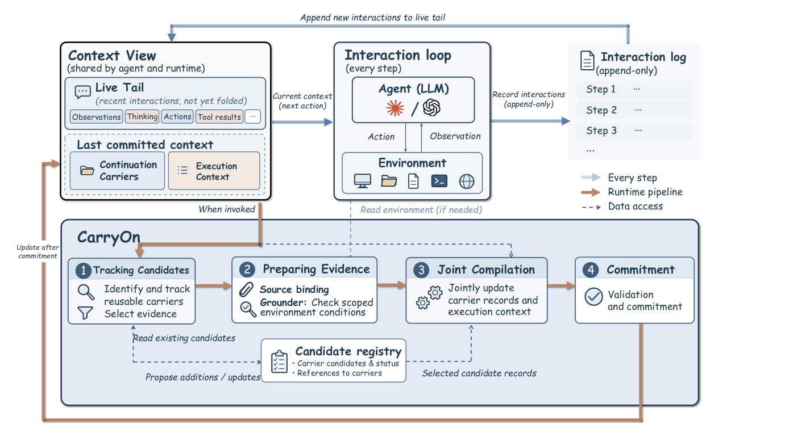
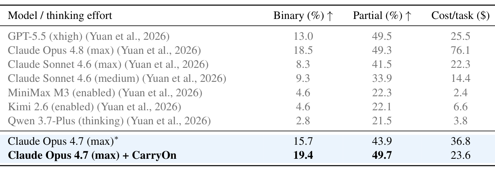
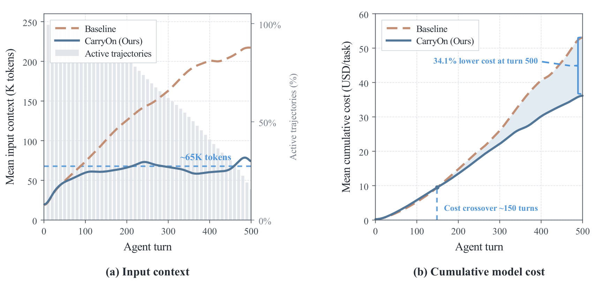

<h1 align="center">Pack Light, CarryOn: Building Object-Oriented Context for Long-Horizon Agents</h1>

<p align="center">
  <a href="https://ethannju.github.io/carryon/"></a>
  <a href="https://arxiv.org/abs/2610.18784"></a>
  <a href="https://huggingface.co/papers/2610.18784"></a>
</p>


https://github.com/user-attachments/assets/5f4a6889-5cf6-41a4-aff1-327a9d5d6b7b


CarryOn is a context runtime for long-horizon agents. Instead of replaying the
interaction history, it builds the agent's context around reusable **task
objects**: carriers for completed work, an execution context for what is left to
do, and a live tail of recent steps. With Claude Opus 4.7 on OSWorld 2.0, it
raises the partial score from 43.9% to 49.7% while cutting tokens by 52% and cost
by 36%.

<p align="center"></p>

## Results

<p align="center"></p>
<p align="center"><sub>Task performance on OSWorld 2.0. CarryOn improves both binary and partial
scores of the same Claude Opus 4.7 agent while cutting cost per task by 35.9%.
* Reproduced with the official benchmark and API.</sub></p>

<p align="center"></p>
<p align="center"><sub>Context and cost over agent turns on OSWorld 2.0. The baseline's input context keeps
growing past 200K tokens, while CarryOn's stays near 65K; by turn 500 the cumulative cost is 34.1% lower.</sub></p>

## Code

The code will be released after the review process.

## Citation

```bibtex
@article{lu2026carryon,
  title   = {Pack Light, CarryOn: Building Object-Oriented Context for Long-Horizon Agents},
  author  = {Lu, Yuchen and McAuley, Julian and Zhang, Lei},
  journal = {arXiv preprint arXiv:2610.18784},
  year    = {2026}
}
```
